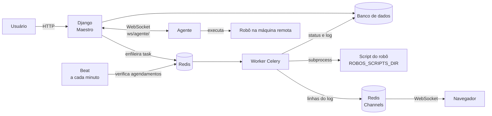

# Maestro

Orquestrador de automações RPA construído em Django. Centraliza o cadastro, a execução, o agendamento e o histórico de robôs de automação, com controle de acesso por perfil e registro completo de cada execução.

Primeiro produto da **ZV Labs**.

> **Sobre o projeto:** o Maestro é desenvolvido como projeto de estudo, dentro de uma trilha de aprendizado em Python, RPA e desenvolvimento web. Apesar disso, é documentado, testado e versionado como um projeto real, e este README descreve o sistema e o seu andamento, não o conteúdo de estudo.

**Versão atual:** 1.1.0. Veja o [CHANGELOG](CHANGELOG.md).

**Começando agora?** Vá direto ao [tutorial](#tutorial-do-zero-ao-primeiro-robô): em 15 minutos você sobe o Maestro, cadastra um robô e acompanha a primeira execução.

---

## Sumário

- [Tutorial: do zero ao primeiro robô](#tutorial-do-zero-ao-primeiro-robô)
- [Funcionalidades](#funcionalidades)
- [Arquitetura](#arquitetura)
- [Stack](#stack)
- [Estrutura do projeto](#estrutura-do-projeto)
- [Como rodar localmente](#como-rodar-localmente)
- [Como rodar com Docker](#como-rodar-com-docker)
- [Rotas](#rotas)
- [Perfis e permissões](#perfis-e-permissões)
- [Execução de robôs](#execução-de-robôs)
- [Agendamento](#agendamento)
- [Status do sistema e retenção](#status-do-sistema-e-retenção)
- [Agentes](#agentes)
- [Modelo de dados](#modelo-de-dados)
- [Testes](#testes)
- [Segurança](#segurança)
- [Andamento](#andamento)
- [Débito técnico](#débito-técnico)
- [Convenções](#convenções)

---

## Tutorial: do zero ao primeiro robô

Este passo a passo leva uns 15 minutos. No fim, você terá o Maestro rodando, um robô cadastrado, uma execução com o log ao vivo, um agendamento e um colega com acesso. Os detalhes técnicos de cada parte estão nas seções seguintes do README; aqui está só o caminho.

### Passo 1: subir o Maestro

O jeito mais simples é o Docker, que sobe tudo de uma vez (Maestro, fila, worker e agendador). Você precisa do [Docker](https://docs.docker.com/get-docker/) com o plugin `compose`.

```bash
git clone https://github.com/Zavan7/maestro-zavan.git
cd maestro-zavan
cp .env.example .env
docker compose up -d --build
```

Com `DEBUG=True`, que já vem no `.env.example`, não é preciso preencher a `SECRET_KEY` para testar. Quando os containers subirem, crie o seu usuário administrador:

```bash
docker compose exec web python manage.py createsuperuser
```

> Prefere rodar sem Docker? Siga [Como rodar localmente](#como-rodar-localmente) e volte para o passo 2.

### Passo 2: entrar

Abra **http://localhost:8000/login/** e entre com o usuário que você acabou de criar. Você cai no **painel**, que mostra os robôs por status, a atividade dos últimos 14 dias e as execuções recentes. Por enquanto ele está vazio.

À esquerda fica o menu: **início**, **robôs**, **execuções**, **agendamentos** e **configurações**.

### Passo 3: escrever o script do robô

Um robô é um script Python comum, dentro da pasta de robôs aprovados. Sem configuração, essa pasta é a `scripts/` do projeto, que já traz o `robo_exemplo.py`. Para um robô seu, crie por exemplo `scripts/ola/main.py`:

```python
import logging
import os
import sys

logging.basicConfig(level=logging.INFO, format="%(levelname)s %(message)s")
log = logging.getLogger("ola")

log.info("Olá, Maestro!")
cliente = os.getenv("ROBO_CLIENTE", "ninguém")
log.info("Trabalhando para %s", cliente)

if cliente == "ninguém":
    log.error("Defina ROBO_CLIENTE no .env")
    sys.exit(1)  # código diferente de 0 = falha
```

Três regras valem para qualquer robô:

1. **Tudo o que ele escreve vira log.** `print`, `logging` e erros, linha a linha. Linhas com `ERROR` ou `Traceback` aparecem destacadas.
2. **Terminar com código 0 é sucesso; qualquer outro, falha.** Uma exceção não tratada também vira falha.
3. **O robô não vê o `.env` do Maestro.** Só passam variáveis básicas do sistema e as que começam com `ROBO_`. Para entregar uma configuração ou senha ao robô, coloque-a no `.env` com esse prefixo, por exemplo `ROBO_CLIENTE=ZV Labs`, e reinicie o worker (`docker compose restart worker`).

Se o robô tem dependências, coloque na pasta dele um `requirements.txt` ou o projeto do seu gerenciador (`uv`, `poetry`, `pdm` ou `pipenv`). O Maestro detecta qual é e instala tudo antes de cada execução; veja [Dependências de cada robô](#dependências-de-cada-robô).

### Passo 4: cadastrar o robô

Vá em **robôs → + novo robô** e preencha:

| Campo | O que colocar | Exemplo |
|---|---|---|
| nome | um nome curto e único | `ola` |
| descrição | o que o robô faz (opcional) | `Primeiro teste` |
| caminho do script | o caminho **relativo** à pasta de robôs | `ola/main.py` |
| status | `Ativo` para poder rodar; `Manutenção` ou `Inativo` impedem o disparo | `Ativo` |
| tempo máximo (segundos) | depois disso, a execução é encerrada e vira falha; vazio usa o padrão (300 s) | `60` |
| novas tentativas após falha | quantas vezes repetir se falhar (0 a 5) | `0` |
| duração esperada (segundos) | só informativo (opcional) | `5` |
| agente | deixe em **nenhum (worker do Maestro)**; agentes ficam no [passo 8](#passo-8-opcional-rodar-robôs-em-outra-máquina) | — |

Clique em **salvar**. O robô aparece na lista com o estado **parado**.

### Passo 5: rodar e acompanhar

1. Na lista de robôs, clique em **iniciar**. O estado muda para **rodando**.
2. Abra **execuções** e clique na execução mais recente. O log aparece **ao vivo**, linha a linha, sem recarregar a página.
3. Quando o robô termina, a tela mostra o status final (**sucesso** ou **falha**), a duração e o log completo.

Se você não definiu `ROBO_CLIENTE`, a execução termina em **falha** com a linha de erro destacada. Defina a variável, reinicie o worker e rode de novo para ver o **sucesso**.

Para interromper um robô no meio, clique em **parar** na lista de robôs. Ele recebe um aviso para encerrar e, se não encerrar em 5 segundos, é finalizado à força, junto com navegadores e outros processos que tenha aberto. A execução fica como **cancelada**.

### Passo 6: agendar

Vá em **agendamentos → + novo agendamento**, escolha o **robô**, o **horário** e marque os **dias da semana**. Clique em **salvar**.

A partir daí, o robô dispara sozinho nesses dias e horário (fuso de São Paulo), e a execução aparece no histórico com a etiqueta **agendado**. Para suspender sem apagar, use **⏸ pausar**; para voltar, **retomar**.

### Passo 7: dar acesso à equipe

Vá em **configurações → gerenciar usuários → + novo usuário**, preencha os dados e escolha o grupo:

| Grupo | Para quem |
|---|---|
| **Operador** | quem acompanha e dispara robôs: vê robôs, execuções e agendamentos; inicia e para |
| **Administrador RPA** | quem cria robôs: tudo do Operador, mais cadastrar, editar e excluir robôs e agendamentos |
| **Administrador do sistema** | quem cuida do Maestro: usuários, agentes, status, retenção e limites; também inicia e para robôs |

Na lista de usuários dá para trocar o grupo, desativar e reativar. Ninguém altera o próprio acesso, e cada um só concede grupos cujas permissões já tem. Tudo fica registrado.

### Passo 8 (opcional): rodar robôs em outra máquina

Quando o robô precisa rodar em outro computador (um servidor do cliente, uma máquina com o sistema que ele automatiza), instale lá o **agente**:

1. No Maestro, vá em **configurações → gerenciar agentes**, dê um nome e clique em **criar agente**. **Copie o token** que aparece: ele é mostrado uma única vez.
2. Na outra máquina, com [Go 1.24+](https://go.dev/dl/) instalado, compile o agente:

   ```bash
   cd maestro-zavan/agente-go
   go build -o agente .
   ```

3. Configure e rode:

   ```bash
   export MAESTRO_URL=wss://maestro.suaempresa.com/ws/agente/
   export MAESTRO_TOKEN=mae_...                 # o token copiado
   export AGENTE_PASTA_ROBOS=/opt/robos         # a pasta dos robôs nesta máquina
   ./agente
   ```

   Para testar com o Maestro na mesma máquina, use `MAESTRO_URL=ws://localhost:8000/ws/agente/`. Fora dela, use `wss://`: o agente recusa `ws://` para outro host, porque o token iria sem criptografia.

4. Em **configurações → gerenciar agentes**, o agente aparece **online**. Agora edite o robô e escolha esse agente no campo **agente**. O caminho do script passa a ser relativo à `AGENTE_PASTA_ROBOS`.

O resto não muda: iniciar, parar, log ao vivo, agendamentos e histórico funcionam do mesmo jeito. Credenciais `ROBO_*` desses robôs ficam no ambiente do agente. No Docker, o agente já vem no `docker-compose.yml`; veja [Agente no Docker](#agente-no-docker).

### Se algo der errado

| Sintoma | O que verificar |
|---|---|
| O botão **iniciar** não aparece | Seu usuário não tem permissão para iniciar robôs; peça o grupo Operador |
| "robô está inativo" ou "robô está manutenção" | Edite o robô e mude o status para `Ativo` |
| "já tem uma execução em andamento" | O robô só roda uma vez por vez; espere terminar ou clique em **parar** |
| A execução fica em **pendente** | O worker está parado. Veja **configurações → status do sistema** e, no Docker, `docker compose logs worker` |
| Falha com "Script não encontrado" ou "Script fora do diretório permitido" | O caminho do script deve ser relativo à pasta de robôs, sem `/` no começo nem `../` |
| Falha com `ambiente_invalido` | A ferramenta de dependências do robô (uv, poetry...) não está instalada onde ele roda |
| O robô não acha uma variável | Ela precisa começar com `ROBO_`, e o worker (ou o agente) precisa ser reiniciado |
| "o agente '...' está offline" | O agente não está conectado: confira o token, a `MAESTRO_URL` e o log do agente |
| Login bloqueado | Foram 5 senhas erradas seguidas; espere 15 minutos ou peça a um administrador para redefinir a senha |
| **403** ao abrir uma tela | Falta a permissão daquela tela; veja [Perfis e permissões](#perfis-e-permissões) |

---

## Funcionalidades

**Disponível hoje**

- Página pública da ZV Labs (portfólio) com acesso ao Maestro
- Login e logout com o sistema de autenticação do Django
- Painel com a distribuição dos robôs por status, atividade dos últimos 14 dias e console com as execuções recentes
- Cadastro, edição e exclusão de robôs, com validação via `ModelForm`
- Execução real de robôs em segundo plano (Celery + Redis), com captura do log
- Botão "parar" que encerra o processo de verdade, inclusive navegadores e outros processos filhos
- Tempo limite e novas tentativas por robô, e limites padrão editáveis na aba de configurações
- Agendamento recorrente por horário e dias da semana, com pausar e retomar
- Estados visuais nas listas: rodando, agendado, pausado e parado, e a próxima execução de cada robô
- Histórico global de execuções, com a origem de cada uma (manual ou agendamento), e tela de detalhe com duração, log numerado e linhas de erro destacadas
- Log ao vivo na tela de detalhe, linha a linha, pelo WebSocket (Django Channels)
- Agentes: cadastro na aba de configurações com token próprio, e o agente em Go, que roda os robôs em outra máquina pelo WebSocket, com fila de reenvio se a conexão cair
- Cada robô roda no ambiente do próprio gerenciador de dependências (uv, poetry, pdm, pipenv ou pip), detectado pela pasta dele
- Controle de acesso por grupos (Operador, Administrador RPA e Administrador do sistema)
- Aba de configurações com gestão de usuários: criação, troca de grupo, desativação e reativação, com registro de todas as alterações
- Status do sistema na aba de configurações: Redis, worker e agendador
- Retenção do histórico editável, com limpeza automática diária pelo beat
- Mensagens de confirmação e de erro em todas as ações
- Segurança: bloqueio de login após senhas erradas, HTTPS em produção e robôs isolados do ambiente do Maestro (veja [Segurança](#segurança))
- Docker: `docker compose up -d --build` sobe tudo, inclusive o agente

**Planejado**

- Alertas de falha, tempo esgotado e atraso
- Agente como serviço do sistema (systemd e serviço do Windows)
- API REST

---

## Arquitetura



Quando um robô é iniciado, pelo botão ou por um agendamento, o disparo passa por uma única função, `disparar_execucao`, que aplica as regras, cria uma `Execucao` com status `pendente` e envia uma task para o Redis. O worker do Celery pega a task, executa o script do robô e grava o status final e o log no banco. Enquanto o robô roda, o worker publica as linhas do log no Django Channels, que as entrega por WebSocket a quem está com a tela de detalhe aberta.

A cada minuto, o beat do Celery envia a tarefa que verifica os agendamentos vencidos e os dispara pelo mesmo caminho, e a tarefa que grava o pulso usado pelo status do sistema. Uma vez por dia, às 03:17, envia a limpeza do histórico.

Um robô também pode rodar num **agente**, instalado na máquina onde o robô vive. O agente abre uma conexão WebSocket com o Maestro, recebe os comandos de iniciar e parar, executa o robô no ambiente dele e devolve o log e como terminou. Robôs sem agente continuam no worker. O Django continua sendo o ponto central de cadastro, permissões e histórico; o robô continua sendo Python. O agente é escrito em Go (`agente-go/`); há também um agente de referência em Python (`tools/agente_referencia.py`), para testar o protocolo.

---

## Stack

| Camada | Tecnologia | Situação |
|---|---|---|
| Backend | Django 6.1 | Em uso |
| Pacotes e ambiente | uv | Em uso |
| Banco de dados | SQLite | Em uso (PostgreSQL previsto para produção) |
| Frontend | Django Templates, HTML e CSS | Em uso |
| Fila e execução assíncrona | Celery + Redis | Em uso |
| Agendamento | Celery beat, com uma tarefa própria (sem `django-celery-beat`) | Em uso |
| Tempo real | Django Channels + `channels-redis`, servido pelo Daphne (WebSocket) | Em uso |
| Execução remota | Agente em Go pelo WebSocket `ws/agente/` | Em uso |
| Login | `django-axes` (bloqueio após senhas erradas) | Em uso |
| Contêineres | Docker e Docker Compose | Em uso (desenvolvimento) |
| API | Django REST Framework + JWT | Planejado |

---

## Estrutura do projeto

```
maestro-zavan/
├── accounts/            # autenticação e painel
├── agente-go/           # agente em Go, que roda os robôs em outra máquina
│   ├── internal/        # config, conexão, execuções, executor, ambiente, proteção
│   └── main.go
├── agents/              # agentes: cadastro, token, protocolo e WebSocket do agente
│   ├── comandos.py      # iniciar, parar e desconectar, enviados ao agente
│   ├── consumers.py     # WebSocket do agente (ws/agente/)
│   ├── protocolo.py     # o que fazer com cada mensagem do agente
│   └── services.py      # criar agente, trocar token, desativar
├── robots/              # cadastro de robôs e disparo de execuções
│   ├── forms.py
│   ├── conclusao.py     # status final e nova tentativa, iguais para worker e agente
│   ├── executor.py      # roda e acompanha o processo, sem Django
│   ├── services.py      # disparar_execucao: o caminho único de disparo
│   ├── tasks.py         # task que executa o robô
│   └── views.py
├── executions/          # histórico e detalhe de execuções
├── scheduler/           # agendamentos e a tarefa que os verifica a cada minuto
│   ├── forms.py
│   ├── models.py
│   ├── tasks.py
│   └── views.py
├── config/              # aba de configurações, permissões e gestão de acesso
│   ├── migrations/      # inclui a migração de dados que cria os grupos
│   ├── forms.py         # retenção e criação de usuário
│   ├── models.py
│   ├── services.py      # regras de acesso, criação de usuário e limpeza do histórico
│   ├── status.py        # verificações de Redis, worker e agendador
│   ├── tasks.py         # pulso do agendador e limpeza diária
│   └── views.py
├── maestro/             # configurações, URLs, app Celery e ASGI
│   ├── asgi.py          # HTTP e WebSocket (Channels)
│   ├── celery.py
│   ├── routing.py       # rotas de WebSocket
│   ├── settings.py
│   └── urls.py
├── docs/agente/         # protocolo do agente (contrato para o agente em Go)
├── tools/               # agente de referência em Python, para testes
├── scripts/             # pasta de robôs permitidos (ROBOS_SCRIPTS_DIR)
│   └── robo_exemplo.py
├── static/
│   ├── css/
│   └── img/
├── templates/
│   ├── base.html
│   ├── portfolio/
│   ├── accounts/
│   ├── robots/
│   ├── executions/
│   ├── scheduler/
│   └── config/
├── CHANGELOG.md
├── Dockerfile           # imagem do Maestro (web e worker)
├── docker-compose.yml
├── manage.py
└── pyproject.toml
```

---

## Como rodar localmente

### Pré-requisitos

- Python 3.14
- [uv](https://docs.astral.sh/uv/)
- Redis

No Ubuntu:

```bash
sudo apt install redis-server
sudo systemctl enable --now redis-server
redis-cli ping   # deve responder PONG
```

### Instalação

```bash
git clone <url-do-repositorio>
cd maestro-zavan
uv sync
```

Crie o `.env` a partir do exemplo e ajuste os valores:

```bash
cp .env.example .env
```

```
SECRET_KEY=
DEBUG=True
ALLOWED_HOSTS=localhost,127.0.0.1
CELERY_BROKER_URL=redis://localhost:6379/0
# ROBOS_SCRIPTS_DIR=/caminho/absoluto/para/scripts
```

`ROBOS_SCRIPTS_DIR` é opcional. Sem ele, o Maestro usa a pasta `scripts/` do projeto.

Com `DEBUG=True`, ou rodando `manage.py test`, uma `SECRET_KEY` vazia é trocada por uma chave fixa de desenvolvimento, então um clone novo roda os testes sem `.env`. Fora disso, sem `SECRET_KEY` o Maestro não sobe e avisa o motivo. Para gerar uma chave:

```bash
uv run python -c "from django.core.management.utils import get_random_secret_key; print(get_random_secret_key())"
```

Prepare o banco:

```bash
uv run manage.py migrate
uv run manage.py createsuperuser
```

O `migrate` também cria os três grupos de acesso com as permissões certas. Não é preciso nenhum comando manual.

### Execução

São dois processos, cada um em um terminal:

```bash
uv run manage.py runserver
```

Com o `daphne` em `INSTALLED_APPS`, o `runserver` é o do Daphne e atende HTTP e WebSocket (a mensagem de início diz "Starting ASGI/Daphne"). Em produção, o servidor é o próprio Daphne: `uv run daphne maestro.asgi:application`.

```bash
uv run celery -A maestro worker -B --loglevel=info
```

O `-B` roda o agendador (beat) junto com o worker, o que basta em desenvolvimento. Em produção, o beat roda como processo separado e único: `uv run celery -A maestro beat --loglevel=info`.

O worker não recarrega sozinho: depois de alterar models ou tarefas, reinicie-o.

Acesse `http://localhost:8000/`.

---

## Como rodar com Docker

Um comando sobe tudo: Redis, Maestro (Daphne), worker do Celery com o agendador e o agente em Go.

```bash
docker compose up -d --build
```

| Serviço | O que roda | Observação |
|---|---|---|
| `redis` | Redis 7.4 | sem porta no host; dados no volume `redis-dados` |
| `web` | `migrate` + `runserver` (Daphne) | `http://localhost:8000`, só na própria máquina |
| `worker` | `celery -A maestro worker -B` | reinicie com `docker compose restart worker` depois de mudar tarefas |
| `agente` | agente em Go | precisa do token (abaixo) |

O código é montado em `/app`, e o `db.sqlite3` é o mesmo do host. Web e worker rodam com o seu usuário (UID 1000), então os arquivos criados continuam seus. Antes de subir, pare o `runserver` e o worker que estiverem rodando fora do Docker: a porta 8000 é a mesma.

### Agente no Docker

1. Suba o Maestro e crie o agente em **configurações → agentes**.
2. Copie `agente.env.example` para `agente.env` e cole o token. Ele fica separado do `.env` para não chegar ao worker, que repassa o próprio ambiente aos robôs.
3. No `.env`, aponte a pasta dos robôs do host com `AGENTE_ROBOS_HOST=/caminho/dos/robos`. Ela é montada em `/robos`, então o caminho do robô no cadastro continua relativo a ela.
4. Rode `docker compose up -d agente`.
5. Baixe os navegadores do Playwright dos robôs (uma vez por versão do Playwright): `docker compose exec agente instalar-navegadores`. Ele acha os robôs que dependem do Playwright, qualquer que seja o gerenciador, e instala no ambiente de cada um.

As imagens do worker e do agente já trazem uv, poetry, pdm e pipenv (versões fixas no topo de cada Dockerfile), então robôs de qualquer uma dessas ferramentas rodam sem instalar nada. No container do agente, o ambiente de cada robô fica no volume `agente-dados` (`AGENTE_PASTA_VENVS`); no do worker, no volume `worker-robos` (`ROBOS_PASTA_VENVS`). O `.venv` da pasta do robô no host não é tocado. Não há tela no container: robôs com Playwright precisam rodar com `headless=True`.

Dentro do compose, o agente fala com o Maestro por `ws://web:8000`, sem TLS, e por isso o serviço define `AGENTE_PERMITIR_WS_SEM_TLS=1`. Um agente em outra máquina deve usar `wss://`.

Para preparar o ambiente de um robô à mão e rodar o Python dele: `docker compose exec agente agente ambiente coleta -- -c "import playwright"` (a pasta é relativa a `/robos`).

Comandos úteis:

```bash
docker compose logs -f agente        # log de um serviço
docker compose exec web python manage.py createsuperuser
docker compose down                  # para tudo (volumes ficam)
```

---

## Rotas

| Rota | Acesso | Descrição |
|---|---|---|
| `/` | Público | Página da ZV Labs |
| `/login/` | Público | Login |
| `/logout/` | Autenticado (POST) | Logout |
| `/painel/` | Autenticado | Painel do Maestro |
| `/robots/` | Autenticado | Lista de robôs |
| `/robots/novo/` | `robots.add_robo` | Cadastro de robô |
| `/robots/<id>/editar/` | `robots.change_robo` | Edição de robô |
| `/robots/<id>/excluir/` | `robots.delete_robo` | Exclusão com confirmação |
| `/robots/<id>/iniciar/` | `robots.executar_robo` (POST) | Dispara uma execução |
| `/robots/<id>/parar/` | `robots.executar_robo` (POST) | Cancela a execução pendente ou pede a parada da que está rodando |
| `/execucoes/` | `executions.view_execucao` | Histórico de execuções |
| `/execucoes/<id>/` | `executions.view_execucao` | Detalhe e log de uma execução |
| `/agendamentos/` | Autenticado | Lista de agendamentos |
| `/agendamentos/novo/` | `scheduler.add_agendamento` | Cadastro de agendamento |
| `/agendamentos/<id>/editar/` | `scheduler.change_agendamento` | Edição de agendamento |
| `/agendamentos/<id>/alternar/` | `scheduler.change_agendamento` (POST) | Pausar ou retomar |
| `/agendamentos/<id>/excluir/` | `scheduler.delete_agendamento` | Exclusão com confirmação |
| `/configuracoes/` | Alguma permissão do app `config` | Aba de configurações |
| `/configuracoes/retencao/` | `config.gerenciar_retencao` (POST) | Salva a retenção do histórico |
| `/configuracoes/limites/` | `config.gerenciar_limites` (POST) | Salva os limites padrão de execução |
| `/configuracoes/agentes/` | `config.gerenciar_agentes` | Lista e cadastro de agentes |
| `/configuracoes/agentes/novo/` | `config.gerenciar_agentes` (POST) | Cria o agente e mostra o token uma vez |
| `/configuracoes/agentes/<id>/token/` | `config.gerenciar_agentes` (POST) | Gera um token novo e derruba a conexão do antigo |
| `/configuracoes/agentes/<id>/alternar/` | `config.gerenciar_agentes` (POST) | Desativa ou reativa o agente |
| `ws/execucoes/<id>/` | `executions.view_execucao` (WebSocket, sessão e origem) | Log ao vivo de uma execução |
| `ws/agente/` | Token de agente (WebSocket) | Conexão do agente |
| `/configuracoes/usuarios/` | `config.gerenciar_usuarios` | Usuários e acesso |
| `/configuracoes/usuarios/novo/` | `config.gerenciar_usuarios` | Criação de usuário |
| `/configuracoes/usuarios/<id>/grupo/` | `config.gerenciar_usuarios` (POST) | Troca de grupo |
| `/configuracoes/usuarios/<id>/alternar/` | `config.gerenciar_usuarios` (POST) | Desativar ou reativar |
| `/admin/` | Superusuário | Admin do Django |

---

## Perfis e permissões

| Grupo | Pode |
|---|---|
| Operador | Ver robôs, execuções e agendamentos; iniciar e parar execuções |
| Administrador RPA | Tudo do Operador, mais cadastrar, editar e excluir robôs e agendamentos |
| Administrador do sistema | Iniciar e parar execuções e acessar todas as seções da aba de configurações |

Permissões próprias do projeto, além das que o Django cria para cada model:

| Permissão | Libera |
|---|---|
| `robots.executar_robo` | Iniciar e parar robôs |
| `executions.view_execucao` | Ver o histórico de execuções e os logs (nas telas e no log ao vivo) |
| `config.gerenciar_usuarios` | Usuários e acesso |
| `config.ver_status_sistema` | Status do sistema |
| `config.gerenciar_retencao` | Retenção do histórico |
| `config.gerenciar_limites` | Limites padrão de execução |
| `config.gerenciar_agentes` | Cadastro de agentes e geração de tokens |

Os grupos são definidos em `config/migrations/0002_grupos_de_acesso.py` e criados pelo `migrate`. As permissões são verificadas nas views: um usuário autenticado sem permissão recebe **403**, e não um redirecionamento para o login. Os botões correspondentes também são ocultados na interface, mas a proteção real é a da view.

Na gestão de usuários, ninguém altera o próprio acesso, e superusuários só podem ser alterados por outro superusuário. Só é possível conceder um grupo cujas permissões você já tem: o Administrador do sistema concede Operador e Administrador do sistema, mas não Administrador RPA (que edita robôs). Os grupos que você não pode conceder nem aparecem nas opções. Usuários criados pela tela são sempre comuns (nunca superusuário nem equipe). Usuários são desativados, nunca excluídos, e cada alteração de acesso, inclusive a criação, fica registrada com autor, alvo e data.

Superusuários ignoram as verificações de permissão. Para testar os perfis, use um usuário comum associado a um dos grupos.

---

## Execução de robôs

### Ciclo de vida

```
pendente  →  rodando  →  sucesso
    ↓           ↓     ↘  falha  →  nova tentativa (se o robô tiver)
cancelada   cancelada
```

1. **pendente**: a execução foi criada e a task enviada para a fila
2. **rodando**: o worker reivindicou a execução (`UPDATE` condicional de `pendente` para `rodando`) e iniciou o script
3. **sucesso**, **falha** ou **cancelada**: o processo terminou; o Maestro grava `finalizado_em`, o status e o log

A reivindicação garante que o worker só roda execuções que ainda estão pendentes: uma execução cancelada na fila, ou uma tarefa entregue duas vezes, não roda o script.

### Executor, parada e tempo limite

O processo é acompanhado por `robots/executor.py`, que não conhece Django nem Celery: recebe o comando, uma função "devo parar?" e uma função "chegou uma linha". É o mesmo contrato que o agente em Go vai seguir.

- O script roda com `python -u` (sem buffer), num grupo de processos próprio. A saída é lida linha a linha por uma thread, então o executor confere o tempo e o pedido de parada a cada segundo, mesmo com o robô calado.
- **Parar**: numa execução pendente, o botão a cancela na hora. Numa execução rodando, marca `parada_solicitada`; em até 1 segundo o executor encerra o processo e a tarefa grava `cancelada`. Enquanto isso, a lista de robôs mostra "parando".
- **Encerramento**: SIGTERM para o grupo inteiro (o robô pode tratar e fechar o navegador), e SIGKILL 5 segundos depois para o que sobrar. Processos filhos (navegador, chromedriver) são encerrados junto, inclusive os que ficaram abertos depois de um robô terminar normalmente.
- **Tempo limite**: o do robô (`timeout_segundos`) ou, se vazio, o padrão da aba de configurações. Estourar o tempo vira `falha`.

### Novas tentativas

`max_tentativas` (0 a 5) conta as tentativas extras depois de uma falha: com 2, o robô roda até 3 vezes. Cada tentativa é uma `Execucao` nova, com o número da tentativa, log e duração próprios, disparada pelo mesmo serviço do botão (então um robô que foi para manutenção não tenta de novo). Não há nova tentativa quando o usuário mandou parar nem quando o script não existe ou está fora da pasta permitida.

Regras aplicadas no disparo, em `robots/services.py`, valendo para o botão e para os agendamentos:

- Só robôs com status **ativo** podem ser iniciados
- Um robô não pode ter duas execuções em andamento (`pendente` ou `rodando`) ao mesmo tempo
- A task só é enviada depois que a execução é gravada no banco (`transaction.on_commit`)

### Onde ficam os scripts

O campo `caminho_script` de um robô é **relativo** à pasta definida em `ROBOS_SCRIPTS_DIR`. Exemplos válidos: `robo_exemplo.py`, `coleta_notas/main.py`.

Caminhos absolutos ou que tentem sair dessa pasta (como `../outro/script.py`) são recusados e a execução termina como falha. Essa pasta funciona como a lista de scripts aprovados: o cadastro de um robô só aponta para um script dentro dela, nunca decide livremente o que executar.

### Logs

Tudo que o script escreve na saída padrão e na saída de erro é salvo no campo `log` da execução. Robôs que usam o módulo `logging` do Python têm os registros capturados automaticamente. Linhas contendo `ERROR` ou `Traceback` aparecem destacadas na tela de detalhe.

### Log ao vivo

Enquanto a execução está pendente ou rodando, a tela de detalhe abre um WebSocket em `ws/execucoes/<id>/` e as linhas aparecem conforme o robô as escreve, sem recarregar a página.

- **No worker**, `LogAoVivo` numera cada linha e, a cada 0,5 s, grava o log no banco e só então publica o lote no grupo `execucao_<id>` do Channels. Os lotes limitam um robô muito falante a poucas escritas e mensagens por segundo.
- **No consumer** (`executions/consumers.py`), a conexão só é aceita para usuário logado (4401) e execução existente (4404), e passa pelo `AllowedHostsOriginValidator`. Ao conectar, ele entra no grupo e só depois lê o log do banco. Como o worker grava antes de publicar, toda linha ou vem nessa leitura ou chega pelo grupo, e nenhuma se perde entre abrir a página e conectar.
- **No navegador** (`static/js/execucao-ao-vivo.js`), as linhas entram com `textContent` (o log nunca é tratado como HTML), números repetidos são ignorados e a rolagem acompanha o fim só se você já estava no fim. No aviso de fim, a página recarrega com o status e a duração finais.
- **Sem conexão** (Redis do Channels fora, por exemplo), a tela volta a recarregar a cada 5 segundos, e a execução segue normalmente: publicar é um extra, e o log completo fica no banco.

Mensagens do WebSocket:

```json
{"tipo": "linhas", "linhas": [{"numero": 12, "texto": "..."}]}
{"tipo": "fim", "status": "sucesso"}
```

O Channels usa o Redis no banco 1 (`CHANNELS_REDIS_URL`, padrão `redis://localhost:6379/1`), separado da fila do Celery. O SQLite roda em modo WAL, com `timeout` de 20 s, para o worker gravar enquanto a tela lê.

### Limites

| Limite | Padrão | Onde muda |
|---|---|---|
| Tempo máximo de execução | 300 segundos (10 a 86.400) | por robô, ou o padrão na aba de configurações |
| Tamanho do log armazenado | últimos 10.000 caracteres (1.000 a 1.000.000) | aba de configurações |

Mudanças nos limites valem a partir da próxima execução.

### Dependências de cada robô

Cada robô roda no ambiente do próprio gerenciador de dependências, detectado pelos arquivos da pasta do script, no worker e no agente com a mesma regra (`robots/ambiente.py` e `agente-go/internal/ambiente`):

| Arquivo na pasta do robô | Ferramenta | Antes de rodar |
|---|---|---|
| `uv.lock`, ou `pyproject.toml` sem seção de outra ferramenta | uv | `uv sync` |
| `poetry.lock`, ou `pyproject.toml` com `[tool.poetry]` | poetry | `poetry install --no-root` |
| `pdm.lock`, ou `pyproject.toml` com `[tool.pdm]` | pdm | `pdm install` |
| `Pipfile.lock` ou `Pipfile` | pipenv | `pipenv sync` ou `pipenv install` |
| `requirements.txt` | pip, num venv | `pip install -r requirements.txt` |
| nenhum | o Python do Maestro (ou do agente) | — |

O log da execução mostra o que foi detectado e a saída do preparo, em linhas `[ambiente]`. O preparo tem limite próprio de 15 minutos; o tempo máximo do robô conta só a execução dele. Se a ferramenta não estiver instalada, a execução falha sem nova tentativa (`ambiente_invalido`); se o preparo falhar, falha com nova tentativa (`preparo_falhou`). O robô nunca herda o venv de quem o roda, nem o ambiente do Maestro: só passam variáveis básicas do sistema (PATH, HOME, idioma, fuso, proxy, certificados, as das ferramentas de dependências) e as que começam com `ROBO_`. Para entregar uma credencial a um robô, use esse prefixo (`ROBO_SENHA_SAP=...`). Os detalhes estão em [`docs/agente/protocolo.md`](docs/agente/protocolo.md#ambiente-do-robô).

Para o worker guardar o ambiente de cada robô fora da pasta dele, defina `ROBOS_PASTA_VENVS` (no Docker, já vem definido).

---

## Agendamento

Cada agendamento tem um robô, um horário e os dias da semana em que dispara. A cada minuto, o beat envia a tarefa `verificar_agendamentos`, que:

1. Busca os agendamentos ativos com o horário do minuto atual e o dia de hoje marcado, no fuso de São Paulo
2. Reivindica cada um com um `UPDATE` condicional em `ultimo_disparo`, o que garante que nenhum agendamento dispare duas vezes no mesmo minuto
3. Dispara pela mesma função do botão "iniciar", registrando a origem e o agendamento na execução

Recusas (robô em manutenção, execução em andamento) viram um aviso no log do worker, sem interromper os outros agendamentos. Um minuto em que o agendador estava parado não é recuperado depois, de propósito.

---

## Status do sistema e retenção

### Status do sistema

A seção mostra três verificações, feitas quando a página abre (só para quem tem `config.ver_status_sistema`):

| Item | Como é verificado |
|---|---|
| Fila (Redis) | `PING` no Redis do `CELERY_BROKER_URL`, com tempo limite de 1 segundo |
| Worker | `inspect().ping()` do Celery; mostra quantos workers responderam |
| Agendador | o beat envia a cada minuto a tarefa `registrar_pulso_agendador`, que grava a hora no Redis com validade de 180 segundos; sem a chave, ou com ela velha, o agendador está parado |

O beat não responde a `ping`, por isso o pulso. Como a tarefa do pulso roda no worker, um agendador "parado" também pode significar worker parado; o item do worker ajuda a separar os dois casos. Se o Redis não responde, worker e agendador aparecem como parados sem nova tentativa, para a página não esperar o tempo limite de cada um.

### Retenção do histórico

O prazo (entre 7 e 3650 dias, padrão 90) é editado na própria aba. Todo dia às 03:17 o beat envia `limpar_historico_antigo`, que apaga as execuções com status `sucesso` ou `falha` finalizadas antes do prazo, junto com o log. Execuções `pendente` ou `rodando` nunca são apagadas.

---

## Agentes

Um agente é a máquina onde robôs rodam fora do worker do Maestro, por exemplo um servidor do cliente com as bibliotecas e os acessos que o robô precisa. O protocolo completo, que o agente em Go vai seguir, está em [`docs/agente/protocolo.md`](docs/agente/protocolo.md).

- **Cadastro**: em configurações → agentes, com a permissão `config.gerenciar_agentes` (do grupo Administrador do sistema). Ao criar o agente, o token aparece uma única vez; o banco guarda só o hash SHA-256. Gerar um token novo invalida o antigo na hora e derruba a conexão aberta com ele. Agentes são desativados, nunca excluídos, e cada alteração fica no registro de acesso.
- **Robô no agente**: no cadastro do robô, o campo "agente" diz em que máquina ele roda, e o caminho do script passa a ser relativo à pasta aprovada do agente. Um agente com robôs não pode ser excluído (`PROTECT`). Sem agente, o robô roda no worker, como antes.
- **Conexão**: o agente conecta em `ws/agente/` com `Authorization: Bearer <token>` e manda um heartbeat a cada 30 s; ele está online enquanto o último sinal tiver menos de 90 s. Uma conexão nova do mesmo agente derruba a anterior.
- **Disparo**: o mesmo `disparar_execucao` do botão e do agendador. Com agente, recusa se ele estiver offline e, depois do commit, manda `iniciar` ao agente em vez da task ao Celery.
- **Execução**: o agente confirma com `iniciado` (o Maestro reivindica a execução como o worker faz), manda o log em lotes e termina com `fim`, informando só o motivo e o código de saída. O status final e a nova tentativa saem de `robots/conclusao.py`, as mesmas regras do worker.
- **Parar**: com o agente online, marca o pedido e manda `parar`; com ele offline, a execução é cancelada na hora, para o robô não ficar travado.
- **Revogação**: cada mensagem do agente confere se ele continua ativo e com o mesmo token; se não, a conexão cai com 4401.
- **Validação**: toda mensagem do agente é validada; um agente só mexe nas execuções dos robôs dele, e mensagem inválida volta como `erro`, sem derrubar a conexão.

Para testar sem o agente em Go, rode o agente de referência em Python:

```bash
export MAESTRO_URL=ws://localhost:8000/ws/agente/
export MAESTRO_TOKEN=mae_...
export AGENTE_PASTA_ROBOS=/caminho/dos/robos
uv run python -m tools.agente_referencia
```

---

## Modelo de dados

### Robo

| Campo | Tipo | Observação |
|---|---|---|
| `nome` | texto | |
| `descricao` | texto | opcional |
| `caminho_script` | texto | relativo a `ROBOS_SCRIPTS_DIR` |
| `status` | escolha | `ativo`, `inativo`, `manutencao` |
| `timeout_segundos` | inteiro | opcional, 10 a 86.400; vazio usa o padrão da configuração |
| `max_tentativas` | inteiro | 0 a 5 tentativas extras depois de uma falha |
| `duracao_esperada_segundos` | inteiro | opcional |
| `responsavel` | FK para usuário | `PROTECT` |
| `criado_em` | data e hora | automático |

### Execucao

| Campo | Tipo | Observação |
|---|---|---|
| `robo` | FK para Robo | `PROTECT` |
| `status` | escolha | `pendente`, `rodando`, `sucesso`, `falha`, `cancelada` |
| `origem` | escolha | `manual`, `agendamento` |
| `agendamento` | FK para Agendamento | `SET_NULL`, opcional |
| `disparado_por` | FK para usuário | `SET_NULL`, vazio em execuções agendadas |
| `iniciado_em` | data e hora | preenchido pelo worker |
| `finalizado_em` | data e hora | preenchido pelo worker |
| `log` | texto | saída do script |
| `tentativa` | inteiro | 1 na primeira; cada nova tentativa é uma execução nova |
| `parada_solicitada` | booleano | marcado pelo botão "parar", lido pelo executor a cada segundo |

### Agendamento

| Campo | Tipo | Observação |
|---|---|---|
| `robo` | FK para Robo | `CASCADE` |
| `horario` | hora | segundos zerados ao salvar |
| `segunda` a `domingo` | sete campos booleanos | pelo menos um marcado |
| `ativo` | booleano | pausar e retomar |
| `ultimo_disparo` | data e hora | preenchido pela tarefa, trava contra disparo duplo |
| `criado_por` | FK para usuário | `SET_NULL` |

Um robô não pode ter dois agendamentos no mesmo horário (restrição de unicidade no banco).

### ConfiguracaoSistema e RegistroAcesso

`ConfiguracaoSistema` tem um único registro, com a retenção do histórico, e é onde as permissões de configuração são declaradas. `RegistroAcesso` guarda cada alteração de acesso (criação, troca de grupo, desativação, reativação), com autor, alvo e data, e não pode ser editado pela interface.

### Decisões de integridade

- **Robô com execuções não pode ser excluído** (`PROTECT`). O histórico é preservado; para aposentar um robô, altere o status para `inativo`.
- **Usuário responsável por robôs não pode ser excluído** (`PROTECT`), para não perder a rastreabilidade de quem responde por cada robô.
- **Excluir o usuário que disparou uma execução não apaga a execução** (`SET_NULL`).
- **Excluir um agendamento não apaga as execuções que ele disparou** (`SET_NULL`), e excluir um robô sem execuções leva junto os agendamentos dele (`CASCADE`).

---

## Testes

```bash
uv run manage.py test
```

| Classe | Cobre |
|---|---|
| `RoboModelTest` | criação, status padrão, exibição do status, regra `PROTECT` no responsável |
| `RobotViewsTest` | acesso sem login, listagem, edição, exclusão com e sem execuções, robô em manutenção, 403 sem `executar_robo` |
| `DisparoTest` | regras do disparo e envio da tarefa só depois do commit |
| `ExecutorTest` | linhas e código de saída, tempo esgotado, parada e encerramento à força de quem ignora o SIGTERM, robô com outro usuário (como root), com processos reais |
| `UsuarioDosRobosTest` | leitura de `ROBOS_USUARIO` (`uid:gid` ou nome) e texto inválido |
| `ProtegerProcessoTest` | sem a proteção o filho lê o `/proc` do pai, com ela não (rode como usuário comum: o root lê tudo) |
| `LogLimitadoTest` | o log guarda o fim, dentro do limite |
| `LogAoVivoTest` | lotes a cada 0,5 s com relógio falso, banco gravado antes do envio, envio do que sobrou no fim |
| `ExecutarRoboTaskTest` | sucesso, tempo do robô e padrão, parada, limite do log, execução não pendente, novas tentativas e quando não repetir, com scripts reais |
| `PararExecucaoTest` | cancelamento de execução pendente, pedido de parada da rodando, "parando" na lista, sem execução e 403 |
| `ExecucaoModelTest` | criação, status padrão, regras `PROTECT` e `SET_NULL` |
| `LogAoVivoViewTest` | WebSocket só para execução em andamento, numeração quando o começo do log foi cortado |
| `ExecucaoConsumerTest` | recusa sem login (4401), sem `view_execucao` (4403) e execução inexistente (4404), log do banco ao conectar, repasse de linhas e fim, fim imediato de execução finalizada |
| `PublicacaoTest` | publicação no grupo da execução e falha do canal sem interromper |
| `ExecutionViewsTest` | acesso sem login, 403 sem `view_execucao`, listagem, detalhe com log, 404 para execução inexistente |
| `AgendamentoModelTest` | validação dos dias, segundos zerados, próxima ocorrência e seus casos de borda |
| `VerificarAgendamentosTest` | disparo no minuto certo, trava contra disparo duplo, pausados, dias desmarcados e robô em manutenção |
| `ScheduleViewsTest` | acesso, permissões, criação, pausa e exclusão mantendo o histórico |
| `ConfiguracaoSistemaTest` | registro único da configuração |
| `AgenteModelTest` | só o hash do token é guardado, estado online pelo último sinal |
| `ProtocoloTest` | autenticação, credencial revogada, reivindicação, linhas numeradas, mensagens inválidas, fim com as regras do worker, nova tentativa no agente |
| `AgenteConsumerTest` | recusa sem token, sinal ao conectar, repasse de comandos, uma conexão por agente (4409), agente revogado derrubado na mensagem seguinte (4401), erro de protocolo, parar para execução cancelada, fluxo completo |
| `DisparoComAgenteTest` | agente offline recusa o disparo, iniciar vai ao agente e não ao worker, parar com agente online e offline |
| `AgentViewsTest` | lista, 403 e 302, token mostrado uma vez e guardado como hash, nome repetido, novo token derruba a conexão, desativar e reativar, GET sem efeito, só agentes ativos no formulário do robô |
| `ConfigHomeTest` | acesso à aba, menu e visibilidade de cada seção por permissão |
| `ServicosDeAcessoTest` | troca de grupo, desativação, travas contra alteração do próprio acesso e de superusuários, grupo com permissões que o autor não tem, registro |
| `ConfigUsersViewsTest` | tela de usuários, permissões, só grupos que o autor pode conceder, grupo inválido, recusas como mensagem e ações só por POST |
| `StatusDoSistemaTest` | Redis respondendo e fora do ar, worker, pulso do agendador recente, ausente e velho |
| `RetencaoTest` | limpeza só das finalizadas antigas, nunca das em andamento, tarefa do beat, edição pela tela, valor inválido, 403 e GET |
| `LimitesPadraoTest` | edição dos limites, valor inválido, 403 e 302 |
| `CriarUsuarioTest` | criação com e sem grupo, senha em hash, nunca superusuário, registro, senhas diferentes, usuário repetido, grupo com mais poder, 302 e 403 |
| `BloqueioDeLoginTest` | bloqueio depois de 5 senhas erradas, abaixo do limite, bloqueio por usuário |
| `LogoutTest` | logout encerra a sessão e volta para a página inicial |

Os testes não precisam do Redis nem do worker: o `TestCase` do Django não dispara callbacks de `transaction.on_commit`, então nenhuma task é enviada durante os testes. Os testes do agendamento fixam o relógio com `mock.patch`, para não depender da hora em que rodam. Os do status do sistema usam um Redis falso em memória, e as telas da aba trocam as verificações reais por um status fixo.

---

## Segurança

- Segredos fora do código, lidos do `.env` (que não é versionado)
- CSRF em todos os formulários
- Ações que alteram dados (logout, excluir, iniciar, parar, pausar, alterar acesso) aceitas apenas via POST
- Validadores de senha padrão do Django ativos
- Login bloqueado por 15 minutos depois de 5 senhas erradas para o mesmo usuário e IP (django-axes)
- HTTPS em produção (`USAR_HTTPS`, ligado por padrão com `DEBUG=False`): cookies `Secure`, redirecionamento para https e HSTS; atrás de proxy, `ATRAS_DE_PROXY_HTTPS` e `CSRF_TRUSTED_ORIGINS`
- Permissões verificadas no backend, com resposta 403, incluindo iniciar e parar robôs
- Nenhum caminho pela interface altera `is_superuser`; ninguém altera o próprio acesso nem concede um grupo com permissões que não tem
- Logs de execução só para quem tem `executions.view_execucao`
- Alterações de acesso registradas e não editáveis
- Execução de scripts restrita a uma pasta aprovada, sem `shell=True` e com tempo limite
- Robôs recebem só uma lista de variáveis permitidas e as `ROBO_*`, nunca o `SECRET_KEY`, o token do agente ou o resto do `.env`
- Worker e agentes não depuráveis (`PR_SET_DUMPABLE`): um robô do mesmo usuário não lê o ambiente deles em `/proc`
- Opcional e recomendado em produção: robôs com outro usuário do sistema (`ROBOS_USUARIO` no worker, `AGENTE_USUARIO_ROBOS` no agente), para não lerem o `.env` nem o banco
- WebSocket do navegador só para usuário logado e com validação de origem (`AllowedHostsOriginValidator`)
- Agente autenticado por token no cabeçalho (nunca na URL), guardado só como hash, mostrado uma única vez e trocável a qualquer momento; a revogação vale já na mensagem seguinte
- O agente em Go recusa `ws://` para host que não seja local e limita a 64 KB cada mensagem recebida
- O agente nunca recebe comando cru: só o identificador do robô, resolvido dentro da pasta aprovada dele
- Log exibido com escape automático do Django (nunca com `|safe`)
- Links externos com `rel="noopener noreferrer"`

---

## Andamento

O acompanhamento diário é feito no [Trello do projeto](https://trello.com/b/B9qsNVe8/maestro-orquestrador-rpa).

### Versão 1.0 (lançada)

Cadastro de robôs, execução em segundo plano, histórico com log, permissões e painel. Detalhes no [CHANGELOG](CHANGELOG.md).

### Versão 1.1 (lançada)

- Agendamento recorrente, com estados visuais e origem das execuções
- Aba de configurações: gestão e criação de usuários com registro de alterações, status do sistema e retenção do histórico com limpeza automática
- Permissão própria para iniciar e parar robôs, e grupos criados por migração

### Versão 1.2: robustez e tempo real (em andamento)

- Pronto: tempo limite e novas tentativas por robô, "parar" que encerra o processo de verdade e limites padrão editáveis
- Pronto: log ao vivo na tela de detalhe, com Django Channels
- Pronto: lado do Maestro para o agente (cadastro, token, protocolo, disparo e parada), com agente de referência em Python
- Pronto: agente em Go, com fila de reenvio, encerramento em árvore e o ambiente de cada robô (uv, poetry, pdm, pipenv ou pip)
- Pronto: Docker Compose com Maestro, worker, agendador e agente
- Pronto: correções da varredura de segurança
- Alertas na tela quando um robô falha, estoura o tempo ou atrasa

### Depois

- Agente como serviço do sistema (systemd e serviço do Windows)
- Clientes e ambientes (servidor da ZV Labs, instalações do cliente ou os dois)
- API REST (DRF + JWT, com limite de requisições)

---

## Débito técnico

| Item | Descrição | Prioridade |
|---|---|---|
| Tipos no código antigo | `robots/views.py` e outros arquivos anteriores à convenção de type hints ainda penduram atributos em models e não passam no `mypy`; adequação num commit de estilo próprio | Baixa |
| Estilos inline | as barras do painel usam `style` inline, o que vai conflitar com uma política de CSP rígida | Baixa |

---

## Convenções

- Commits em português, descrevendo o que mudou e o motivo
- Templates com uma tag do Django por linha
- `base.css` concentra variáveis de tema e componentes usados em mais de uma tela; cada tela tem o próprio CSS
- Rotas referenciadas sempre pelo nome (``), nunca pelo caminho escrito à mão
- Regras de negócio usadas por mais de um lugar moram em funções de serviço, sem conhecimento de HTTP
- Nenhuma funcionalidade é considerada pronta sem revisão de permissão, CSRF e validação de entrada

---

Desenvolvido por **Vitor Zavan**, sob a marca **ZV Labs**.

[GitHub](https://github.com/Zavan7) | [LinkedIn](https://www.linkedin.com/in/vitor-zavan-831907297/)