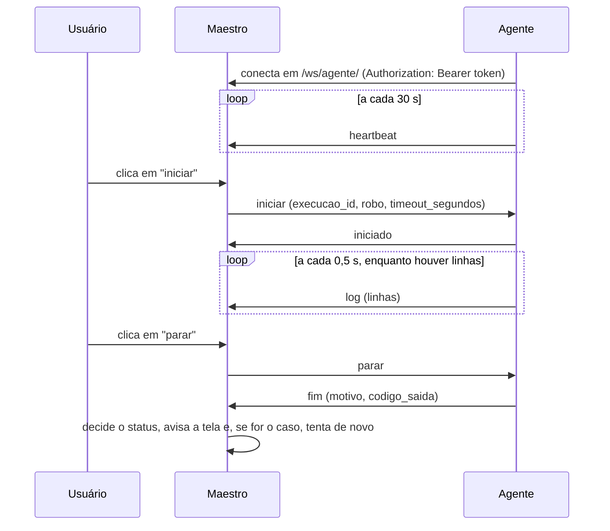

# Protocolo do agente

Especificação da conversa entre o **agente** (o programa instalado na máquina onde os robôs rodam) e o **Maestro**. O lado do Maestro já está pronto e testado; este documento é o contrato que o agente em Go precisa seguir.

A implementação de referência em Python, `tools/agente_referencia.py`, segue tudo o que está aqui e serve para testar o Maestro de ponta a ponta antes de o agente em Go existir.

---

## Visão geral



O agente **conecta** no Maestro, e nunca o contrário: conexão de saída passa por firewall e NAT sem abrir porta na máquina do robô. O Maestro decide **o que** roda e **quando**; o agente decide **como** rodar, dentro da própria pasta aprovada, e informa **como terminou**. Quem transforma o fim em status (`sucesso`, `falha`, `cancelada`) e decide se haverá nova tentativa é sempre o Maestro.

---

## Conexão

| Item | Valor |
|---|---|
| Endereço | `ws://<host>/ws/agente/` em desenvolvimento; **`wss://`** em produção |
| Autenticação | cabeçalho `Authorization: Bearer <token>` |
| Formato | cada mensagem é um objeto JSON em texto UTF-8, com o campo `tipo` |
| Conexões por agente | uma; uma nova conexão com o mesmo token derruba a anterior |

O token é gerado na aba de configurações (**configurações → agentes**), aparece uma única vez e começa com `mae_`. O Maestro guarda só o hash SHA-256. O token vai no cabeçalho, e nunca na URL, para não aparecer em logs de servidor e de proxy.

O agente não manda `Origin` nem cookie: a rota do agente não passa pelas proteções do navegador, e a única credencial é o token.

### Recusa e fechamento

| Situação | O que acontece |
|---|---|
| Sem token, token errado ou agente desativado | o aperto de mão é recusado com HTTP **403**; não adianta tentar de novo com o mesmo token |
| Outra conexão do mesmo agente foi aberta | esta conexão fecha com o código **4409** |
| O token foi trocado ou o agente foi desativado na aba | a conexão fecha com o código **4401** |
| Queda de rede ou Maestro reiniciado | a conexão cai; o agente reconecta |

**Reconexão:** espera crescente (1 s, 2 s, 4 s… até 30 s) e volta a 1 s depois de conectar. Um 403 encerra o agente com uma mensagem clara, porque o token não vale mais.

---

## Mensagens do Maestro para o agente

### `iniciar`

```json
{"tipo": "iniciar", "execucao_id": 42, "robo": "coleta_notas/main.py", "timeout_segundos": 300}
```

| Campo | Tipo | Significado |
|---|---|---|
| `execucao_id` | inteiro | identifica a execução em todas as mensagens seguintes |
| `robo` | texto | identificador do robô, **relativo à pasta aprovada do agente** |
| `timeout_segundos` | inteiro | tempo máximo; o do robô ou, se ele não define, o padrão da aba de configurações |

Ao receber, o agente:

1. Responde `iniciado` com o mesmo `execucao_id`.
2. Resolve `robo` dentro da pasta aprovada (veja **Segurança**). Se o caminho sair da pasta ou o script não existir, manda uma linha de `log` com o motivo e um `fim` com `motivo: "script_invalido"`, sem `codigo_saida`.
3. Roda o robô, enviando o log em lotes, e manda `fim` quando o processo terminar.

Um agente pode rodar execuções de robôs diferentes ao mesmo tempo. O Maestro nunca manda duas execuções do mesmo robô juntas.

### `parar`

```json
{"tipo": "parar", "execucao_id": 42}
```

O agente encerra o processo da execução: primeiro o pedido educado (SIGTERM, ou o equivalente no Windows), e 5 segundos depois à força, **incluindo os processos filhos** (navegador, chromedriver). Depois manda `fim` com `motivo: "parado"`.

Se a execução ainda não começou, ou já terminou, `parar` é ignorado. O agente também recebe `parar` como resposta a um `iniciado` de uma execução que foi cancelada no caminho: nesse caso, não roda o robô (ou o encerra, se já começou).

### `erro`

```json
{"tipo": "erro", "mensagem": "campo 'linhas' precisa ser lista de textos"}
```

Resposta a uma mensagem do agente que não segue o protocolo. A conexão continua. O agente deve registrar o erro no próprio log: ele indica um bug no agente.

---

## Mensagens do agente para o Maestro

### `heartbeat`

```json
{"tipo": "heartbeat"}
```

A cada **30 segundos**. O Maestro considera o agente online enquanto o último sinal (heartbeat ou conexão) tiver menos de **90 segundos**. Com o agente offline, o botão "iniciar" de um robô dele é recusado, e o "parar" cancela a execução na hora, porque não há quem receba o pedido.

### `iniciado`

```json
{"tipo": "iniciado", "execucao_id": 42}
```

Confirma que o agente recebeu o `iniciar` e vai rodar. O Maestro marca a execução como `rodando` e anota o início. Se ela tinha sido cancelada nesse meio tempo, o Maestro responde `parar`.

### `log`

```json
{"tipo": "log", "execucao_id": 42, "linhas": ["2026-10-21 10:00:01 [INFO] Etapa 1 de 3", "..."]}
```

| Regra | Valor |
|---|---|
| Frequência | um lote a cada **0,5 s** enquanto houver linhas novas; nada quando o robô está calado |
| Linhas | saída padrão e de erro juntas, na ordem em que o robô escreveu, sem a quebra de linha |
| Limite por mensagem | **1.000 linhas**, cada uma com até **10.000 caracteres**; acima disso, divida em mais mensagens |
| Quando | só depois do `iniciado` e antes do `fim` |

O Maestro numera as linhas na ordem de chegada, grava o fim do log (até o limite da aba de configurações) e as repassa a quem está com a tela de detalhe aberta. Rode o robô **sem buffer de saída** (para Python, `-u` ou `PYTHONUNBUFFERED=1`), senão as linhas só chegam no fim.

### `fim`

```json
{"tipo": "fim", "execucao_id": 42, "motivo": "concluido", "codigo_saida": 0}
```

| `motivo` | Quando | `codigo_saida` | Status que o Maestro grava | Nova tentativa? |
|---|---|---|---|---|
| `concluido` | o processo terminou sozinho | o código de saída | `sucesso` se 0; `falha` nos outros | sim, se falhou |
| `tempo_esgotado` | passou de `timeout_segundos` e o agente encerrou | o do processo encerrado | `falha` | sim |
| `parado` | encerrado por causa do `parar` | o do processo encerrado | `cancelada` | não |
| `script_invalido` | o robô nem chegou a rodar | ausente ou `null` | `falha` | não |

Antes do `fim`, mande o último lote de `log`. Um `fim` de execução que o Maestro já encerrou (cancelada porque o agente ficou offline, por exemplo) é ignorado sem erro.

---

## Validação no Maestro

Toda mensagem do agente é validada antes de tocar no banco:

- `tipo` desconhecido, campo faltando ou com tipo errado (`execucao_id` precisa ser inteiro, `linhas` lista de textos) → `erro`.
- Um agente só mexe nas execuções dos robôs **dele**. `log` ou `fim` de execução de outro agente → `erro`.
- `log` de execução que não está `rodando` → `erro`.

---

## Segurança

1. **O agente nunca recebe comando cru.** `robo` é um identificador, resolvido dentro da pasta aprovada do agente: `(pasta / robo).resolve()` precisa continuar dentro de `pasta` (o que barra `../`, caminhos absolutos e links simbólicos para fora). Mesmo um Maestro comprometido não consegue mandar executar um comando qualquer.
2. **Sem shell.** O processo é iniciado com a lista de argumentos, nunca por um interpretador de comandos.
3. **Token como segredo.** Guarde-o fora do código (variável de ambiente ou arquivo com permissão só do usuário do agente). Se vazar, gere outro na aba: o antigo deixa de valer e a conexão aberta com ele cai.
4. **`wss://` em produção.** Sem TLS, o token viaja em texto.

---

## Para o agente em Go

O que o agente em Go precisa ter, além do que a referência em Python já faz:

- **Ambiente de cada robô:** cada robô é uma pasta com o próprio `pyproject.toml`; o agente roda `uv run main.py` dentro dela, e as dependências são as daquele robô. A referência usa o Python do próprio ambiente, por simplicidade.
- **Encerramento em árvore:** no Linux, grupo de processos próprio (`Setpgid`) e sinal para o grupo; no Windows, Job Object. `exec.CommandContext` sozinho mata só o processo principal.
- **Fila de reenvio:** se a conexão cair no meio de uma execução, guardar `log` e `fim` e reenviar depois de reconectar. A referência perde essas mensagens. O Maestro ignora `fim` repetido, mas linhas de `log` reenviadas aparecem duplicadas; reenvie só o que não saiu.
- **Configuração:** `MAESTRO_URL`, `MAESTRO_TOKEN` e a pasta aprovada, lidos do ambiente ou de um arquivo de configuração.
- **Serviço:** rodar como serviço do sistema (systemd ou serviço do Windows), com o próprio log.

### Como testar contra o Maestro

1. Suba o Maestro (`uv run manage.py runserver`, que é o Daphne) e o Redis.
2. Em **configurações → agentes**, crie um agente e copie o token.
3. Cadastre um robô com esse agente e o caminho relativo à pasta do agente.
4. Rode o agente em Go:

   ```bash
   cd agente-go
   go build -o agente .
   export MAESTRO_URL=ws://localhost:8000/ws/agente/
   export MAESTRO_TOKEN=mae_...                    # troque pelo token do agente
   export AGENTE_PASTA_ROBOS=/caminho/dos/robos     # troque pela pasta aprovada
   ./agente
   ```

   `AGENTE_UV` e `AGENTE_PYTHON` são opcionais (padrão `uv` e `python3`). Os testes do agente rodam com `go test ./...`.
5. Inicie e pare o robô pela tela; o log aparece ao vivo na tela de detalhe.

Para comparar o comportamento, rode a referência em Python no lugar do agente em Go:

```bash
export MAESTRO_URL=ws://localhost:8000/ws/agente/
export MAESTRO_TOKEN=mae_...
export AGENTE_PASTA_ROBOS=/caminho/dos/robos
uv run python -m tools.agente_referencia
```
